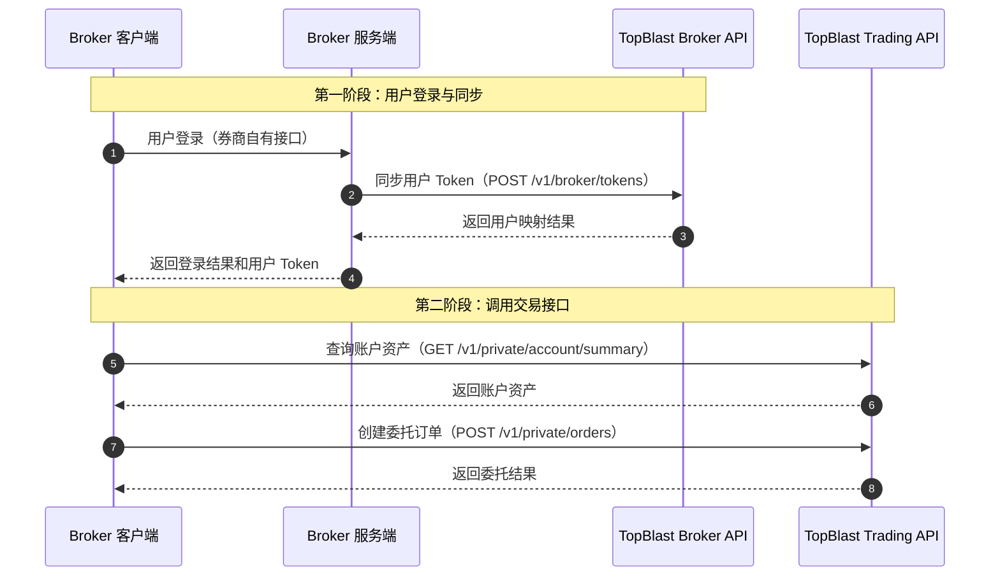
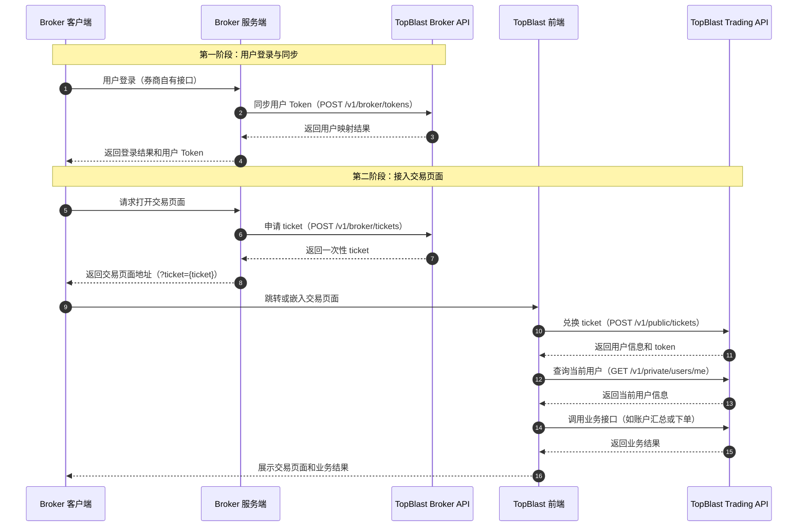

## API 接入

券商使用自有客户端承载交易体验；完成用户同步后，客户端直接调用 TopBlast Trading REST API 查询账户和执行交易。

### 流程图



### 流程说明

1. **用户登录**：用户在 Broker 客户端登录。该步骤使用券商自己的登录接口，不调用 TopBlast API。
2. **同步用户 Token**：Broker 服务端调用 `POST /v1/broker/tokens`，提交 `brokerUserId` 和用户 Token。请求需要携带 Broker App ID、时间戳和签名。
3. **返回用户映射结果**：TopBlast 建立或更新用户映射，并将平台用户信息返回给 Broker 服务端。后续响应中的 `userId` 表示 TopBlast 平台用户 ID。
4. **返回登录结果和用户 Token**：Broker 服务端将登录结果和用户 Token 返回给客户端。不要把 Broker App Secret 返回给客户端。

5. **查询账户资产**：Broker 客户端调用 `GET /v1/private/account/summary`。请求必须携带 `x-app-id: <broker_app_id>` 和 `Authorization: Bearer <access_token>`。
6. **返回账户资产**：TopBlast Trading API 完成 Token 鉴权，并返回当前用户的账户资产。
7. **创建委托订单**：Broker 客户端调用 `POST /v1/private/orders` 创建委托订单。请求继续携带 `x-app-id` 和 Bearer Token。其他 Trading REST API 使用相同的鉴权方式。
8. **返回委托结果**：TopBlast Trading API 返回委托结果，Broker 客户端据此更新交易页面。

<Warning>
用户 Token 只能通过 `Authorization` Header 传递。不要将 Token 放入 URL、查询参数或日志中，也不要在客户端保存 Broker App Secret。
</Warning>

## 白标接入

券商将用户跳转至或嵌入 TopBlast 提供的交易页面，通过一次性 ticket 完成登录，页面展示和交易交互由 TopBlast 承载。

### 流程图



### 流程说明

1. **用户登录**：用户在 Broker 客户端登录。该步骤使用券商自己的登录接口，不调用 TopBlast API。
2. **同步用户 Token**：Broker 服务端调用 `POST /v1/broker/tokens`，提交 `brokerUserId` 和用户 Token。请求需要携带 Broker App ID、时间戳和签名。
3. **返回用户映射结果**：TopBlast 建立或更新用户映射，并将平台用户信息返回给 Broker 服务端。
4. **返回登录结果和用户 Token**：Broker 服务端将登录结果和用户 Token 返回给客户端。不要把 Broker App Secret 返回给客户端。

5. **请求打开交易页面**：用户在 Broker 客户端进入交易入口，客户端向 Broker 服务端请求打开交易页面。
6. **申请一次性 ticket**：Broker 服务端调用 `POST /v1/broker/tickets`，提交已同步的 `brokerUserId` 和 Token。请求同样需要 Broker 签名。返回的 `ticket` 有效期为 5 分钟，且只能成功兑换一次。
7. **返回 ticket**：TopBlast Broker API 将一次性 `ticket` 返回给 Broker 服务端。
8. **生成交易页面地址**：Broker 服务端将 `ticket` 拼接到交易页面地址中，再把地址返回给客户端：

   ```text
   https://predict-dev.topblast.trade?ticket={ticket}
   ```

9. **跳转交易页面**：Broker 客户端跳转到或内嵌该地址。页面 URI 中只能传递 `ticket`，不能传递用户 Token 或 App Secret。
10. **兑换 ticket**：TopBlast 前端调用 `POST /v1/public/tickets`，请求体为 `{ "ticket": "..." }`，将 ticket 兑换为用户 Token。第一次兑换尝试后，`ticket` 立即失效。
11. **返回登录信息**：兑换成功后，Trading API 返回用户信息和 Token：

   ```json
   {
     "appid": "...",
     "userId": "...",
     "token": "...",
     "email": "...",
     "brokerUserId": "..."
   }
   ```

12. **查询当前用户**：TopBlast 前端携带兑换得到的 Token 调用 `GET /v1/private/users/me`，确认当前登录用户。
13. **返回当前用户信息**：Trading API 返回交易页面初始化所需的用户资料。
14. **调用业务接口**：TopBlast 前端继续携带 Token 调用交易接口，例如 `GET /v1/private/account/summary` 查询账户汇总，或 `POST /v1/private/orders` 创建委托。
15. **返回业务结果**：Trading API 返回账户、委托或其他交易数据。
16. **展示页面**：TopBlast 前端向用户展示交易页面和业务结果。

<Warning>
请始终使用 HTTPS。`ticket` 必须短时有效且只能成功兑换一次。不要在 URI 中传递用户 Token 或 App Secret。
</Warning>
