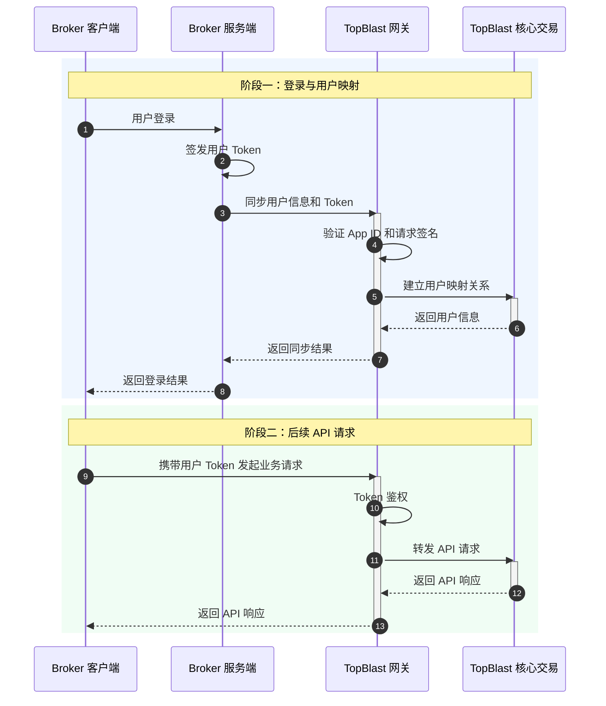

券商通过 API 接入 TopBlast。接入流程分为登录与用户映射、后续 API 请求两个阶段。

## API 接入流程

券商用户登录成功后，券商服务端调用 `POST /v1/broker/tokens`，将 `brokerUserId`（券商系统中的用户 ID）和 Token 同步到 TopBlast。如果用户映射不存在，TopBlast 会在同步过程中自动创建。后续响应中的 `userId` 表示平台用户 ID。

完成用户映射后，券商客户端携带用户 Token，直接调用 TopBlast API 查询资产、下单或发起其他业务请求。

