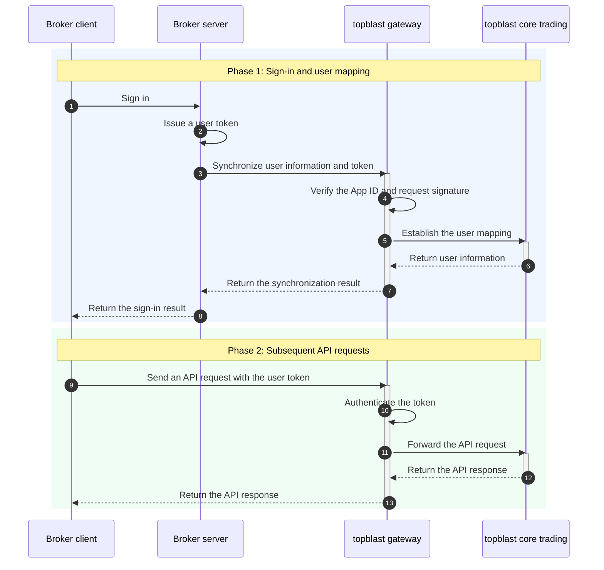

The broker integrates with topblast through APIs. The flow has two phases: sign-in and user mapping, followed by subsequent API requests.

## API integration flow

After a broker user signs in, call `POST /v1/broker/tokens` from the broker server to synchronize `brokerUserId`—the user ID in the broker system—and the token with topblast. Topblast automatically creates the mapping if it does not exist. In subsequent responses, `userId` identifies the platform user.

After the user mapping is established, the broker client sends the user token directly to the topblast API to query assets, place orders, or make other business requests.

