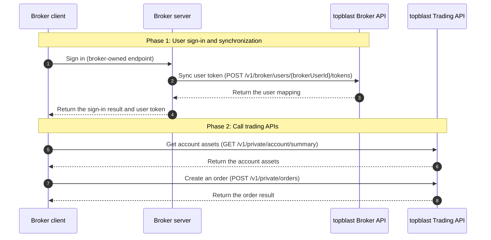
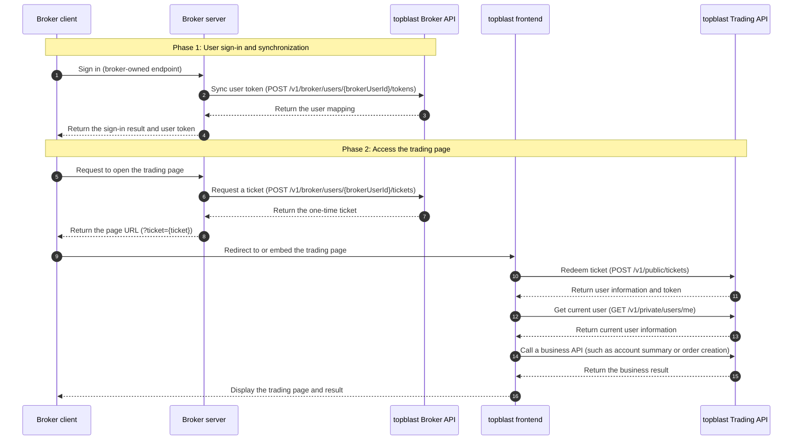

## API integration

The broker provides the trading experience in its own client. After synchronizing the user, the client calls the topblast Trading REST API directly to query the account and execute trades.

### Flowchart



### Flow details

1. **Sign in**: The user signs in through the broker client. This step uses the broker's own endpoint and does not call a topblast API.
2. **Synchronize the user token**: The broker server calls `POST /v1/broker/users/{brokerUserId}/tokens`, passing `brokerUserId` in the path and the user token in the request body. The request must include the Broker App ID, timestamp, and signature.
3. **Return the user mapping**: Topblast creates or updates the user mapping and returns the platform user information to the broker server. In subsequent responses, `userId` identifies the topblast platform user.
4. **Return the sign-in result and user token**: The broker server returns the sign-in result and user token to the client. Never return the Broker App Secret to the client.

5. **Get account assets**: The broker client calls `GET /v1/private/account/summary`. The request must include `x-app-id: <broker_app_id>` and `Authorization: Bearer <access_token>`.
6. **Return account assets**: The topblast Trading API authenticates the token and returns the current user's account assets.
7. **Create an order**: The broker client calls `POST /v1/private/orders` to create an order. The request continues to include `x-app-id` and the bearer token. Other Trading REST API operations use the same authentication method.
8. **Return the order result**: The topblast Trading API returns the order result, and the broker client updates the trading interface.

<Warning>
Pass the user token only through the `Authorization` header. Never put the token in a URL, query parameter, or log, and never store the Broker App Secret in the client.
</Warning>

## White-label integration

The broker redirects users to or embeds the trading page provided by topblast. Users sign in with a one-time ticket, while topblast provides the page and trading interactions.

### Flowchart



### Flow details

1. **Sign in**: The user signs in through the broker client. This step uses the broker's own endpoint and does not call a topblast API.
2. **Synchronize the user token**: The broker server calls `POST /v1/broker/users/{brokerUserId}/tokens`, passing `brokerUserId` in the path and the user token in the request body. The request must include the Broker App ID, timestamp, and signature.
3. **Return the user mapping**: Topblast creates or updates the user mapping and returns the platform user information to the broker server.
4. **Return the sign-in result and user token**: The broker server returns the sign-in result and user token to the client. Never return the Broker App Secret to the client.

5. **Request to open the trading page**: The user enters the trading area in the broker client, which asks the broker server to open the trading page.
6. **Request a one-time ticket**: The broker server calls `POST /v1/broker/users/{brokerUserId}/tickets`, passing the synchronized `brokerUserId` in the path and no request body. Topblast issues the ticket with a previously synchronized token that is still active. This request also requires the Broker signature. The returned `ticket` is valid for five minutes and can be successfully redeemed only once.
7. **Return the ticket**: The topblast Broker API returns the one-time `ticket` to the broker server.
8. **Build the trading page URL**: The broker server adds the `ticket` to the trading page URL and returns the URL to the client:

   ```text
   https://predict-dev.topblast.trade?ticket={ticket}
   ```

9. **Open the trading page**: The broker client redirects to or embeds the URL. Pass only the `ticket` in the page URI. Never pass the user token or App Secret.
10. **Redeem the ticket**: The topblast frontend calls `POST /v1/public/tickets` with `{ "ticket": "..." }` to exchange the ticket for a user token. The `ticket` becomes invalid immediately after the first redemption attempt.
11. **Return the session information**: After a successful redemption, the Trading API returns the user information and token:

   ```json
   {
     "appid": "...",
     "userId": "...",
     "token": "...",
     "email": "...",
     "brokerUserId": "..."
   }
   ```

12. **Get the current user**: The topblast frontend calls `GET /v1/private/users/me` with the redeemed token to confirm the signed-in user.
13. **Return the current user**: The Trading API returns the profile required to initialize the trading page.
14. **Call business APIs**: The topblast frontend continues to use the token for trading APIs, such as `GET /v1/private/account/summary` for the account summary or `POST /v1/private/orders` to create an order.
15. **Return the business result**: The Trading API returns account, order, or other trading data.
16. **Display the page**: The topblast frontend displays the trading page and business result to the user.

<Warning>
Always use HTTPS. The `ticket` must be short-lived and successfully redeemed only once. Never pass the user token or App Secret in the URI.
</Warning>
